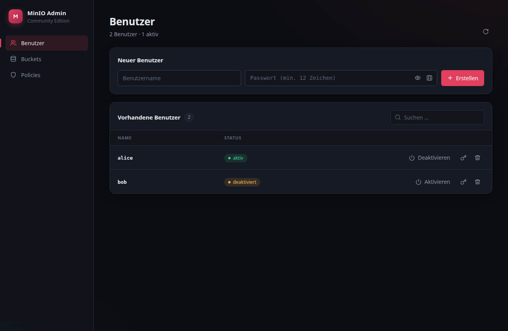
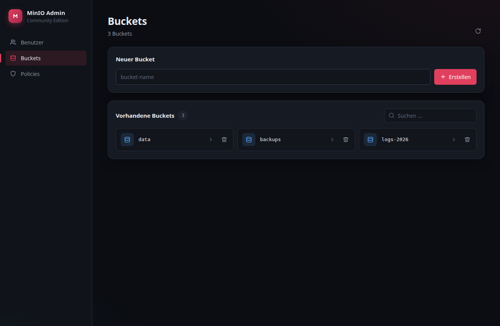
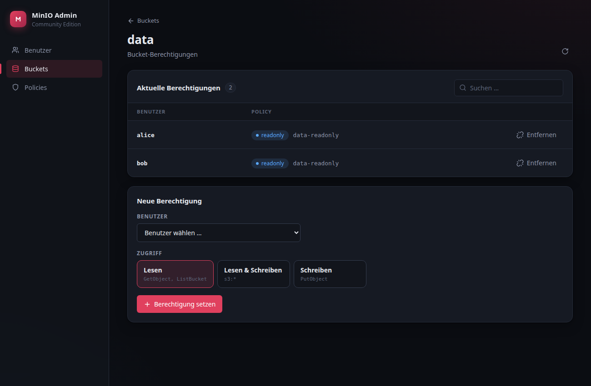
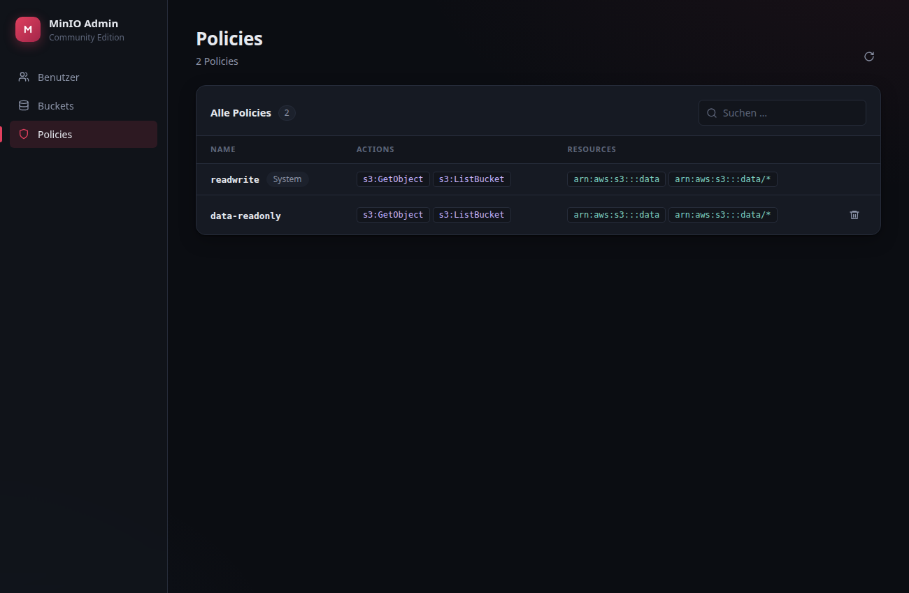

# simple minio web manager for minio community edition
* uses mc client for access to the admin api
* provides management of
  * users
  * buckets
  * ACLs
  * policies
* frontend: static HTML + vanilla JS (no framework, no build step), served by FastAPI from `static/`
* JSON API under `/api/*`; write requests require the header `X-Requested-With: minioaccess` (CSRF protection)

## Screenhots





## get uv - makes python life easier
```
curl -LsSf https://astral.sh/uv/install.sh | sh
```

## run
```
uv sync
uv run uvicorn main:app --host 0.0.0.0 --port 9002
```

### from scratch
- uv lock --upgrade
- uv sync
- uv run ruff check .
- uv run pyright .
- uv run pytest
- uv pip compile pyproject.toml -o requirements.txt
- uv run uvicorn main:app --reload

### get local mc client
```
./getclient.sh
```
Downloads `mc` for the current OS and architecture (linux/darwin, amd64/arm64) to `./mc` and verifies its SHA-256 checksum.
Override the version with `MC_VERSION=RELEASE.… ./getclient.sh`.

The MinIO client project is archived: `dl.min.io` answers `410 Gone`, so `mc` is taken from the
[GitHub releases of minio/mc](https://github.com/minio/mc/releases). The last release is `RELEASE.2025-08-13T08-35-41Z`.

## Docker build
```
docker build -t minioweb .
# multi-arch
docker buildx build --platform linux/amd64,linux/arm64 -t minioweb .
```
`mc` is pinned via `ARG MC_VERSION`, the per-architecture checksums are `ARG MC_SHA256_AMD64` / `ARG MC_SHA256_ARM64`.
When changing the version, update all three (values from the `.sha256sum` files of the release) and `getclient.sh`.
The image runs as non-root user `appuser`; app files and `mc` stay owned by root.

## Health endpoints
| Endpoint | Checks | Use |
|---|---|---|
| `GET /healthz` | process answers, no `mc` call | liveness probe, Docker `HEALTHCHECK` |
| `GET /readyz` | `mc admin info` succeeds (MinIO reachable, admin credentials valid), else `503` | readiness probe |

The app also refuses to start if MinIO is not reachable at startup.

```yaml
livenessProbe:
  httpGet: { path: /healthz, port: 9002 }
readinessProbe:
  httpGet: { path: /readyz, port: 9002 }
  periodSeconds: 30
  timeoutSeconds: 20   # > MC_TIMEOUT
```

## set env vars
```
export MINIO_ACCESS_KEY=xxxxxx
export MINIO_SECRET_KEY=xxxxxx
export MINIO_ENDPOINT=https://gmk.lan:9000
export MINIO_ALIAS=gmk
# optional
export MC_BINARY=/usr/local/bin/mc   # default: mc from PATH, else ./mc (Docker image: /app/mc)
export MC_TIMEOUT=15                 # seconds per mc call, default 15
```

## Docker run
```
docker run --rm -p 9002:9002 \
  -e MINIO_ACCESS_KEY=$MINIO_ACCESS_KEY \
  -e MINIO_SECRET_KEY=$MINIO_SECRET_KEY \
  -e MINIO_ENDPOINT=$MINIO_ENDPOINT \
  -e MINIO_ALIAS=$MINIO_ALIAS \
  minioweb
```

## Docker run daemon
```
docker run --name minioweb -d -p 9002:9002 \
  -e MINIO_ACCESS_KEY=$MINIO_ACCESS_KEY \
  -e MINIO_SECRET_KEY=$MINIO_SECRET_KEY \
  -e MINIO_ENDPOINT=$MINIO_ENDPOINT \
  -e MINIO_ALIAS=$MINIO_ALIAS \
  --restart unless-stopped wlanboy/minioweb
```